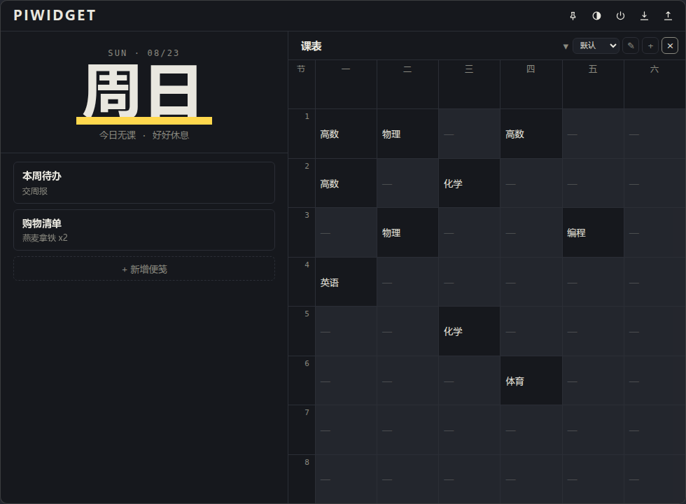

<div align="center">


# PiWidget

桌面便笺 + 周课表小组件 · Tauri v2 + Vue 3 · 数据全部本地

</div>



## 功能

- **便笺** — 新增 / 展开编辑 / 删除 / 拖拽排序，收起时显示标题 + 首行摘要
- **多套课表** — 8 节 × 6 天，自由新建 / 切换 / 重命名 / 删除，点格即改，今日列荧光高亮
- **窗口** — 无边框透明圆角卡片，可拖动缩放；置顶、透明化一键切换
- **开机自启** — 标题栏开关，随系统登录启动
- **数据** — 编辑防抖自动保存，`Ctrl+S` 立即落盘，一键导入 / 导出 JSON
- **主题** — 墨色 `#16181D` + 荧光笔黄 `#FFD84D`，深色护眼

## 快速开始

```bash
npm install
npm run tauri dev     # 开发（前端热重载）
npm run tauri build   # 打包安装包
```

## 打包产物（Windows）

| 包 | 路径 |
| --- | --- |
| NSIS 安装包 | `src-tauri\target\release\bundle\nsis\PiWidget_x64-setup.exe` |
| MSI | `src-tauri\target\release\bundle\msi\PiWidget_x64.msi` |

## 数据与隐私

- 数据仅存本地：`%APPDATA%\com.piwidget.app\data.json`，**无任何网络请求**
- 旧版 PureWidget 数据在 `%APPDATA%\com.purewidget.app\data.json`，升级后点一次「导入」手动迁入
- v1 / v2 旧格式自动迁移；文件损坏自动备份 `.bak` 并恢复默认
