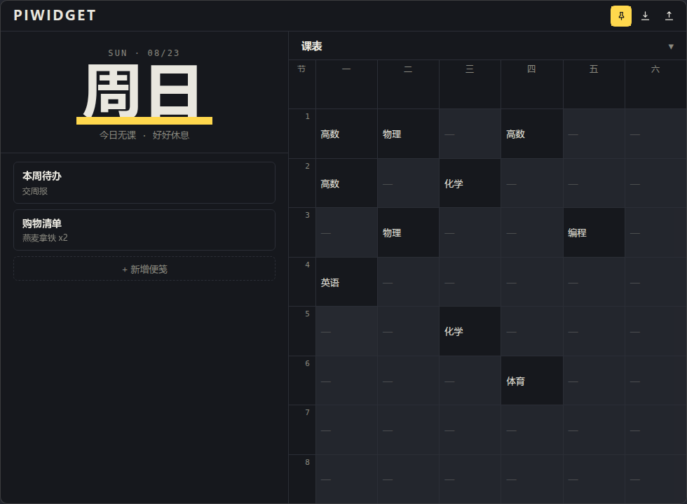

<div align="center">


# PiWidget

自用桌面便笺 + 周课表小组件 · Tauri v2 + Vue 3，数据全部本地

</div>



## 功能

- **便笺列表** — 新增 / 点击展开编辑 / 删除 / 拖拽排序，收起时显示标题 + 首行摘要
- **周课表** — 8 节 × 6 天，无具体时间；点格子即改（Enter 提交 / Esc 取消），今日列荧光高亮，面板可折叠
- **无边框窗口** — 透明圆角卡片钉在桌面，可拖动、可缩放、置顶切换
- **自动保存** — 编辑防抖落盘，`Ctrl+S` 立即保存
- **导入 / 导出** — 一键备份 JSON，换机迁移
- **墨色主题** — `#16181D` 墨底 + 荧光笔黄 `#FFD84D`，深色护眼

## 快速开始

```bash
npm install
npm run tauri dev     # 开发（前端热重载）
npm run tauri build   # 打包安装包
```

Windows 包产物：

| 包 | 路径 |
| --- | --- |
| NSIS 安装包 | `src-tauri\target\release\bundle\nsis\PiWidget_x64-setup.exe` |
| MSI | `src-tauri\target\release\bundle\msi\PiWidget_x64.msi` |

## 数据与隐私

- 数据文件：`%APPDATA%\com.piwidget.app\data.json`（Windows），无任何网络请求
- 旧版 PureWidget 的数据在 `%APPDATA%\com.purewidget.app\data.json`，**升级后需点一次「导入」手动迁入**
- 更早的 v1 格式数据加载时自动迁移；文件损坏自动备份 `.bak` 并恢复默认

## 目录

```
src/
  components/   TitleBar · Hero · NoteList · NoteCard · Timetable
  store/        useStore.js（状态 + 持久化 + 迁移）· useToast.js
  styles/       tokens.css（六色 token）· base.css
src-tauri/      tauri.conf.json（无边框窗口）· src/lib.rs（data_path 命令）
.github/        workflows/release.yml（打 tag 自动出草稿 release）
```
